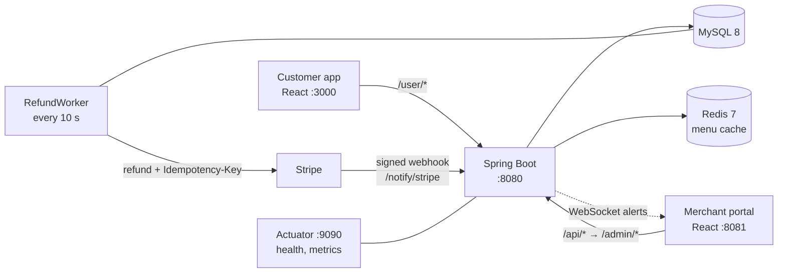
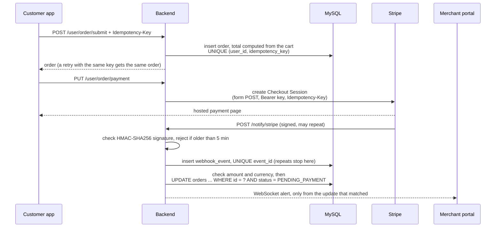
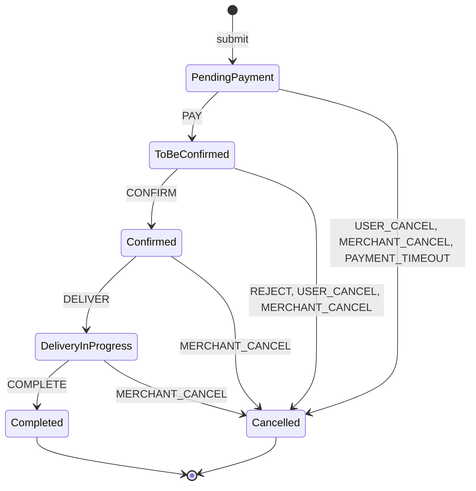

# Sky Take-Out

[](https://github.com/JacksonXue2004/sky-take-out/actions/workflows/ci.yml)

A food-ordering platform with a customer app and a merchant portal. Customers browse an English menu, fill a cart, place and pay for an order; merchants get a real-time alert and accept, deliver and complete it.

## The problem

The features are ordinary. Keeping them correct when things happen at the same time, or twice, is the interesting part:

- A customer double-clicks **Place order**, or the network drops the response and the client retries. That must not create two orders.
- The merchant presses **Accept** while the customer presses **Cancel**, or two staff members act on the same order. Exactly one action may win.
- Stripe delivers each webhook *at least once*, retries for days until it gets a 2xx, and anyone on the internet can call the endpoint. A payment must be applied once, only if it is genuine and matches the order.
- A refund call to Stripe can time out after Stripe has already refunded. Retrying must not refund twice, and a slow Stripe must not block order processing.
- Customers must only ever see and act on their own orders.

## Origin

Sky Take-Out (苍穹外卖) started as a team project in a Java backend course, on the course's starter code. My part was the menu, cart and order APIs, the Redis menu cache, the WebSocket order alerts and the unpaid-order timeout job. After the course I continued alone in this repository: I moved the customer app to React, added Docker and CI, and did the reliability and security work this README describes.

## Architecture



Each React app is served by its own Nginx, which also proxies API calls to the backend. The backend and its management port are not published outside Docker.

### Checkout and payment



The demo customer app replaces the Stripe steps with a simulated payment that goes through the same paid-order code path (see [Known limitations](#known-limitations)).

### Order states

Every allowed change is declared once in [`OrderTransition`](sky-pojo/src/main/java/com/sky/entity/OrderTransition.java):



Cancelling or rejecting a paid order queues a refund.

## How correctness is enforced

- **Conditional status updates.** Each transition runs `UPDATE orders SET status = ? WHERE id = ? AND status = ?`. When two requests act on one order, only one update matches; the other gets an explicit "order was updated by another request" error. The scheduled jobs use the same updates, so they never overwrite an order that moved on.
- **Idempotent checkout.** The customer app sends an `Idempotency-Key` per checkout attempt. The key is stored with the order under `UNIQUE (user_id, idempotency_key)`, so when requests with one key race, the database lets exactly one insert through and the others return the winner's order.
- **Server-side totals.** The order total is computed from the cart, whose prices the server copied from the menu. The request has no amount field to tamper with.
- **Webhook pipeline.** After the signature check, every Stripe event is stored in `webhook_event` under its unique event id. A repeat of a finished event is answered without doing anything. The event must say `payment_status: paid` and match the order's amount and currency. Signed but unusable events (unknown order, wrong amount, malformed) are kept as `REJECTED` and answered with 200, because Stripe's retries could not fix them. A payment that arrives after the timeout already cancelled the order is refunded automatically.
- **Refund outbox.** Cancelling a paid order writes a `refund_task` row in the same transaction instead of calling Stripe. `RefundWorker` sends it afterwards with `Idempotency-Key: refund-<order>`, retries after 1 min, 5 min, 15 min, 1 h and 3 h, and leaves it `FAILED` for manual handling after the sixth attempt or a refusal from Stripe. `UNIQUE (order_id)` means an order can never get two refunds. Tasks are claimed with conditional updates, so several instances can run the worker.
- **Circuit breaker.** A Resilience4j breaker opens when at least half of the last 10 Stripe calls (and at least 5 calls) failed on Stripe's side, then fails calls fast for 30 seconds.
- **Ownership checks.** Customer endpoints load orders and addresses through user-scoped lookups. Another customer's order is reported as "not found", so ids cannot be probed.
- **Credentials.** Passwords are hashed with BCrypt; old MD5 hashes are upgraded at the next successful login. Login requests and JWTs are no longer logged, and password fields are left out of `toString`.
- **A closed shop takes no orders.** Placing an order reads the shop's status from MySQL and refuses a new order while the shop is closed; a retry of an order placed before it closed still gets that order back. The customer pages read a copy that Redis keeps for up to 5 minutes.
- **Database-enforced uniqueness.** UNIQUE keys back every "only once" rule: order numbers (random UUIDs), idempotency keys per customer, webhook event ids, and refund tasks per order.

## Trade-offs

| Decision | Alternatives | Why |
| --- | --- | --- |
| Conditional `UPDATE ... WHERE status = ?` | `SELECT ... FOR UPDATE`; a version column | The status already acts as the version, and no lock is held while the application decides. A version column would need every write to bump it. |
| Idempotency key as a MySQL unique constraint | Redis `SETNX` | The check and the insert are one atomic step in the same transaction. Redis would be a second system that can disagree with MySQL (key set but insert failed, key expired). |
| Outbox table and a polling worker | RabbitMQ or Kafka | Writing the task is atomic with the order update and adds no infrastructure. A queue would still need an outbox to avoid the dual-write problem. The cost is up to 10 seconds of latency, which is fine for refunds. |
| Payment timeout by polling every minute | Delay queue | Simple, and safe to run on every instance because of the conditional updates. Orders may be cancelled up to a minute late; `(status, order_time)` is indexed for the scan. |
| 200 for signed but rejected webhooks | 4xx | Stripe retries non-2xx responses for days, and retrying cannot fix a wrong amount. The stored event is the audit trail. |
| Hand-written form POSTs to Stripe | `stripe-java` | Two calls, with full control over timeouts, idempotency keys and error mapping, tested against a local stand-in for Stripe. A wider use of Stripe would justify the SDK. |
| Shop status in MySQL, with a copy in Redis | Redis only, as in the course | A Redis restart, which empties a free Render Key Value instance, silently reopened a closed shop. Orders are checked against MySQL, so a stale copy can only show the wrong badge, never let an order through. |
| Actuator on a separate internal port | Same port behind a filter | Nothing outside Docker can reach it, and it keeps Actuator's mappings away from springfox, which breaks on them in Spring Boot 2.6+. |

## Load test

[`scripts/load/checkout.js`](scripts/load/checkout.js) (k6) runs three scenarios at once for 60 seconds with no think time: 20 customers adding to the cart, placing and paying orders nonstop; one customer sending every order 10 times at once with the same Idempotency-Key; and a merchant pressing Accept and Reject 4 times each, at once, on each paid order.

| Request | p50 | p95 | max |
| --- | ---: | ---: | ---: |
| Place order | 25.3 ms | 62.4 ms | 192.6 ms |
| Pay (simulated) | 35.6 ms | 99.8 ms | 254.2 ms |
| Add to cart | 35.2 ms | 99.6 ms | 214.5 ms |
| Merchant accept or reject | 20.3 ms | 51.0 ms | 167.4 ms |

- 40,494 requests in 60 s (about 695 per second), 0 failed.
- Every retried checkout (10 identical requests at once) produced exactly one order.
- 382 accept-versus-reject races, each with exactly one winning action.
- Afterwards, no idempotency key belonged to two orders and every order had its order lines.

Measured on one Windows 11 laptop: MySQL 8.0 and Redis 7 in Docker Desktop, the backend jar on the host (Temurin 21, Druid's default pool of 8 connections), k6 in Docker, pointed straight at the backend. These numbers show how the system behaves under concurrency on one machine. They are not a capacity claim.

To run it against the Docker setup (the defaults go through the Nginx proxies):

```bash
docker run --rm -i grafana/k6 run - < scripts/load/checkout.js
```

In PowerShell, use `Get-Content -Raw scripts/load/checkout.js | docker run --rm -i grafana/k6 run -`. On Linux, add `--add-host=host.docker.internal:host-gateway`. Set `CUSTOMERS`, `DURATION`, `USER_API` or `ADMIN_API` with `-e` to change the run.

## Before and after

The same k6 load, run against the previous version of this repository (commit `6e15a40`, original schema) and against this version. Each run used a fresh database seeded from that version's own `docker/mysql/init`, on the same machine as above: 20 customers checking out nonstop plus one customer sending every order 10 times at once, for 60 s (`-e LEGACY=1 -e SKIP_RACE=1`). The middle column is this version without the indexes from `003`, to show which change produced which gain.

| | Before (`6e15a40`) | After, without indexes | After |
| --- | ---: | ---: | ---: |
| Completed checkouts per second | 98.2 | 132.5 | 216.4 (+120%) |
| Place order, p95 | 86.1 ms | 80.4 ms | 41.2 ms (−52%) |
| Add to cart, p95 | 96.3 ms | 73.6 ms | 49.7 ms (−48%) |
| Pay, p95 | 74.5 ms | 75.0 ms | 49.6 ms (−33%) |
| Payments that failed | 986 of 6,880 (14.3%) | 0 | 0 |
| Orders that shared an order number | 1,551 of 8,788 (17.6%) | 0 | 0 |
| Extra orders created by retried checkouts | 1,578 in 330 retries | 0 | 0 |

- **Before:** order numbers came from `System.currentTimeMillis()`, so at this load orders created in the same millisecond shared a number, and the payment lookup by number then found two rows and failed. Each retried checkout (10 identical requests) created 5.8 orders on average.
- **The fixes are in the code:** the middle column, without the indexes, already has no failed payments and no duplicates.
- **Most of the speed-up comes from the indexes:** without `idx_shopping_cart_user`, every checkout's cart delete scanned and locked the whole cart table, so customers waited on each other.
- **Test coverage** of the Spring Boot module (JaCoCo): lines 22.7% → 41.3%, branches 17.4% → 43.1%.

Each column is a single run. Treat the percentages as the size of the change on this machine, not as a production benchmark.

## Known limitations

- **Payments are simulated in the demo.** The customer app marks orders paid through the simulated checkout. Stripe Checkout sessions, the webhook pipeline and refunds are implemented and tested against a local stand-in for Stripe and with signed simulated events, but have not been run against a Stripe test account.
- **One backend instance for alerts.** Merchant WebSocket sessions live in the process that accepted them. With several instances, a merchant only gets alerts from the instance it is connected to; a shared channel such as Redis pub/sub would fix that.
- **Manual follow-up has no UI.** `FAILED` refunds and `REJECTED` webhook events are logged, counted in the metrics and kept in their tables, but someone has to query them.
- **Metrics stay inside the app.** Actuator's in-memory registry holds the counters; Prometheus, dashboards and alerting are not set up.
- **Older platform.** Java 8 and Spring Boot 2.7, whose open-source support has ended, with springfox-based API docs. Moving to Java 17 and Spring Boot 3 is a larger migration.
- **Other gaps.** The payment timeout can run up to a minute late. Image upload needs Aliyun OSS credentials. The delivery-range check is turned off. Order numbers are 32-character UUIDs, which are safe but not friendly to read out.

## Tech stack

- Customer: React 19, TypeScript, Vite, Zustand, Tailwind CSS
- Merchant: React 18, TypeScript, Vite, Ant Design, ECharts
- Backend: Java 8, Spring Boot 2.7, MyBatis, JWT, WebSocket, Resilience4j, Spring Boot Actuator
- Data: MySQL 8 and Redis 7
- Testing: JUnit 5, Mockito, Testcontainers, k6
- Delivery: Docker Compose, Nginx, GitHub Actions, GitHub Container Registry

## Quick start with Docker

### Requirements

- Windows 10/11, macOS, or Linux
- Docker Desktop or Docker Engine with Compose
- Git

### 1. Clone and configure

```bash
git clone https://github.com/JacksonXue2004/sky-take-out.git
cd sky-take-out
cp .env.docker.example .env
```

On Windows PowerShell, use:

```powershell
git clone https://github.com/JacksonXue2004/sky-take-out.git
Set-Location sky-take-out
Copy-Item .env.docker.example .env
```

Open `.env` and replace every `replace-with-...` value. These values are local secrets and must not be committed.

### 2. Start the complete application

```bash
docker compose up -d --build
docker compose ps
```

The first build downloads base images and may take several minutes. Wait until MySQL, Redis, and the backend report `healthy`.

If you created the `mysql-data` volume before `docker/mysql/init/003-order-reliability.sql` existed, apply that file once; [docker/mysql/init/README.md](docker/mysql/init/README.md) has the command.

### 3. Open the applications

| Application | URL | Credentials |
| --- | --- | --- |
| Customer app | http://localhost:3000 | Create an account in the UI |
| Merchant portal | http://localhost:8081 | `admin` / `123456` |

The included demo database contains only non-sensitive English menu data: 30 dishes and 4 combos, with photos from Wikimedia Commons that ship with the frontends ([credits](sky-frontend-user/public/images/dishes/CREDITS.md)). Prices and UI amounts are displayed in US dollars.

## Five-minute product walkthrough

1. Open the customer app and create an account.
2. Add an item from the English menu to the cart.
3. Open the cart and proceed to checkout.
4. Add a US delivery address and place the order.
5. The demo checkout simulates a successful payment; no payment card is required.
6. Open the merchant portal in another browser window and sign in.
7. Open **Orders**. The new order appears under **Pending Acceptance** and also generates a WebSocket notification.
8. Select **Accept**, then **Start Delivery**, and finally **Complete**.
9. Return to **My Orders** in the customer app and confirm that the order is completed.

## Simulating Stripe webhooks

[`scripts/stripe_webhook_simulator.py`](scripts/stripe_webhook_simulator.py) signs events the way Stripe does and sends six deliveries for one order: a tampered body, a replay ten minutes late, a signed event with the wrong amount, a valid payment, and the same event twice more. Set `STRIPE_WEBHOOK_SECRET` in `.env`, restart the backend, place an order without paying, then run:

```bash
python scripts/stripe_webhook_simulator.py --url http://localhost:3000/notify/stripe \
    --secret "<your STRIPE_WEBHOOK_SECRET>" --order <order number> --amount <order total>
```

It prints every response and whether it matched the expected outcome. It needs only the Python standard library.

## Operations

- **Health:** `docker compose exec backend wget -qO- http://localhost:9090/actuator/health` shows the database and Redis checks. Docker's own healthcheck uses the same endpoint.
- **Metrics:** `/actuator/metrics/<name>` on the same port: `orders.placed`, `stripe.webhook.events` and `refunds` (both tagged by `outcome`), and `stripe.circuit.open`.
- **Request ids:** every response carries an `X-Request-Id`, and every log line written while handling that request shows the same id after the log level.
- **Follow-up:** refunds that need a person are in `refund_task` with status `FAILED`; webhook events that need review are in `webhook_event` with status `REJECTED`. Both keep the error.
- **Simulated checkout:** controlled by `PAYMENT_SIMULATION_ENABLED`. `compose.yml` turns it on for the local demo, and `compose.production.yml` leaves it off unless set, because it lets customers mark their own orders paid.

## Services and ports

| Service | Host port | Purpose |
| --- | ---: | --- |
| Customer React | 3000 | Customer ordering experience |
| Merchant React | 8081 | Merchant operations portal |
| MySQL | 3307 | Optional host database access |
| Redis | 6380 | Optional host cache access |
| Spring Boot | internal only | Reached through the frontend Nginx proxies |
| Actuator | internal only | Port 9090 inside the backend container |

The customer proxy preserves `/user/*` and `/notify/*`. The merchant proxy maps `/api/*` to the existing `/admin/*` endpoints and preserves WebSocket upgrades on `/ws/*`.

## Testing

```bash
mvn -pl sky-server -am test
```

143 tests: 123 unit tests (JUnit 5 and Mockito) and 20 integration tests. The integration tests use Testcontainers and need a running Docker engine; without Docker they are skipped. Their MySQL is initialized from `docker/mysql/init`, the same scripts Docker Compose runs, so every schema migration is tested. They cover, among others:

- confirm and reject racing on the same paid order: exactly one wins, and only a winning rejection queues a refund
- ten concurrent checkouts with one Idempotency-Key: one order, one set of order lines
- simulated Stripe deliveries over HTTP: repeats, a tampered body, a late replay, a wrong amount, a malformed event and a late payment
- the refund outbox: retry scheduling and recovery of a task left behind by a crashed worker
- two customers checking out at once without waiting for each other's cart locks
- Actuator health and metrics on the management port, and SCAN-based cache clearing against Redis 7

## Local development without Docker

### Backend

Start local MySQL on port 3306 and Redis on port 6379, and create the schema from the files in `docker/mysql/init`. Configure the ignored `sky-server/src/main/resources/application-dev.yml`, then run `com.sky.SkyApplication` from IntelliJ IDEA or package the Maven project.

### Merchant React app

```bash
cd sky-frontend-admin
npm install
npm run dev
```

### Customer React app

```bash
cd sky-frontend-user
npm install
npm run dev
```

## CI/CD

Every push and every pull request to `main` runs:

- Backend unit tests, the MySQL and Redis integration tests, and Maven packaging
- Merchant React production build
- Customer React production build
- Linux validation builds for all three Docker images

After changes reach `main`, a version tag such as `v1.0.0` or a manual workflow dispatch can publish immutable images to GitHub Container Registry. See [the detailed CI/CD and Docker guide](docs/CI-CD-DOCKER.md).

To put them online, see [the deployment guide](docs/DEPLOY.md): free on Render, Vercel and TiDB Cloud, or on one small VM, free for a year with Azure for Students.

## Repository structure

```text
sky-frontend-admin/   Merchant React application
sky-frontend-user/    Customer React application
sky-server/           Spring Boot application
sky-common/           Shared backend utilities
sky-pojo/             Backend entities, DTOs, and VOs
docker/               Runtime configuration, demo seed and schema migrations
deploy/               Setup scripts for one VM, launchers for Azure and AWS, and the TiDB Cloud database setup
render.yaml           Render Blueprint for the backend and its Redis cache
scripts/              Stripe webhook simulator and k6 load test
.github/workflows/    CI and image publishing workflows
```

## Notes

- Database schemas and public API contracts remain owned by the Spring Boot backend.
- No production credentials or real customer data are included in the repository.
